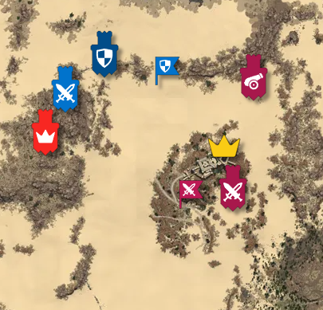

# bdo-sieges

<div align="center" width="100%">
  
</div>

Интерактивная карта для планирования осад в Black Desert Online. Позволяет разместить на игровой карте объекты (форты, флаги, маркеры) и визуализировать ход осады.

## Возможности

- узлы и территории с подсветкой регионов;
- пользовательские маркеры: цвет, иконка, подпись, перетаскивание;
- линейка с расстоянием в игровых метрах;
- рисование фигур (Leaflet-Geoman);
- панорамы 360°;
- обмен картой через код импорта/экспорта;
- русский и английский языки, светлая и тёмная тема (клавиша `D`).

## Разработка

```bash
pnpm i
pnpm dev        # локальный сервер
pnpm typecheck  # проверка типов
pnpm lint
pnpm build      # статическая сборка в ./out
```

## Структура

```
app/              точка входа Next.js
components/
  map/            компоненты карты (слои, меню, диалоги)
  ui/             примитивы shadcn/ui
data/             узлы, территории и панорамы (JSON, игровые координаты)
hooks/            состояние и сохранение в localStorage
lib/map/          координаты, иконки, валидация маркеров, коды обмена
messages/         переводы
types/            общие типы
```

Тайлы карты предоставлены [nodewar.gg](https://nodewar.gg/).
